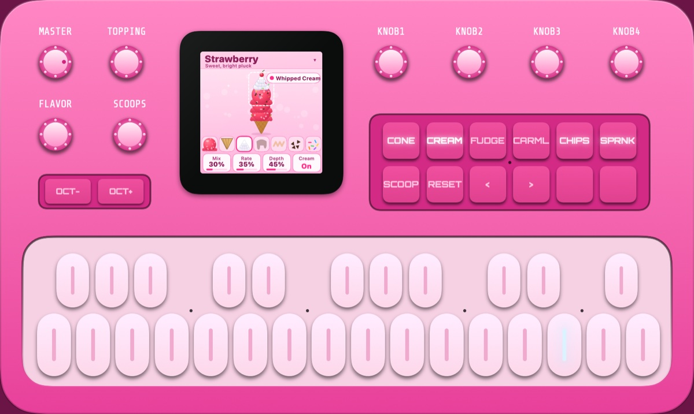

# MF-1

Two things for the M-VAVE FM-1 pocket FM synthesizer, sharing one engine:

- **The MF-1 app**: a native macOS emulator of the FM-1. It has the same panel, screens, engine and MIDI/SysEx
  behaviour, so patches, librarians and workflows made for the FM-1 work with it. It also has an
  [iScream](#iscream) mode.
- **[iScream firmware](#firmware-for-the-fm-1)**: iScream running on the FM-1 itself, in place of M-VAVE's
  firmware. Its engine renders the same samples as the app.

## Install

Download `MF-1-<version>.dmg` from the GitHub releases, open it and drag MF-1 to Applications.
The app runs on Apple silicon and Intel Macs with macOS 14 or later.

The app is ad-hoc signed, not notarised. On first launch, right-click MF-1 in Applications and
choose Open, then confirm. Alternatively, run `xattr -dr com.apple.quarantine /Applications/MF-1.app`.

## Build and run

Requires macOS 14+ and Xcode command line tools (Swift 5.9+).

```sh
scripts/build-app.sh        # builds build/MF-1.app
open build/MF-1.app
```

A release DMG (universal binary, version from `VERSION`):

```sh
scripts/make-dmg.sh         # builds build/MF-1-<version>.dmg
```

Headless checks and a benchmark:

```sh
swift build -c release
.build/release/mf1-render Sources/MF1/Resources/Banks test
.build/release/mf1-render Sources/MF1/Resources/Banks bench
.build/release/mf1-render Sources/MF1/Resources/Banks wav 1 piano.wav 60
```

## Design

- **Engine** (`Sources/MF1Core`, C++17): the FM-1 firmware runs Google's
  [msfa](https://github.com/google/music-synthesizer-for-android) DX7 core, with tables
  identical byte for byte, so the engine is msfa too. Around it: 12-voice round-robin
  allocation as in the firmware, mono with glide (Full Time / Fingered), the per-patch ENV
  amp envelope, the reorderable 6-slot mono FX chain, the 7-mode arpeggiator, the 16-pattern
  × 16-step sequencer with per-step rate, chains and long notes, and MIDI clock.
- **FM-1 V15 behaviour** (Device › FM-1 V15 Hardware Behaviour, on by default): the
  deviations from msfa measured on real units, from `docs/research/`: detune about 2.8 cents
  per step, feedback at a quarter strength, the FM-1 tremolo depths (AMS 3 silences at each
  trough), vibrato × 0.88, pitch EG 1.37× slower, incoming velocity × 100/127, aftertouch
  vibrato, operator mute key mapping reversed, edits reaching only the next note, 16-bit
  output, 20 Hz high-pass and 5.6 kHz low-pass on the output. Turn it off for a clean DX7.
- **Realtime**: the audio thread renders 64-sample blocks from a Core Audio output unit. It
  takes commands from a lock-free queue and never locks or allocates. 12 voices with every
  effect on use about 0.4% of one Apple-silicon core.
- **UI** (`Sources/MF1`, SwiftUI): the panel is laid out in millimetres from a top-down photo
  of the unit. The 240×240 screen is drawn in screen pixels and scaled.

## Loading patches

The app publishes a virtual MIDI port named **MF-1 (FM-1 Compatible)**. Web librarians and
editors that look for an "FM-1" port find it, and it answers as the hardware does:

| What | How |
|---|---|
| DX7 32-voice bank (`F0 43 0n 09 20 00 …`, 4104 bytes) | the screen asks for a bank: turn KNOB1–4 for A–D; saved at once, and remembered as the "last imported" bank for Reset Patches |
| DX7 single voice (`F0 43 0n 00 01 1B …`, 163 bytes) | loads the edit buffer; hold SAVE to keep it |
| DX7 parameter change (`F0 43 10 gg pp vv F7`) | writes the edit buffer |
| M-VAVE vendor protocol (`F0 00 32 …`, packed `00 59` packets) | identify, voice-store writes (the factory restore tool) and edit-buffer reads |
| FX CCs 0–23 on the FX channel (default 2), PC, pitch bend, CC1/64, aftertouch, clock | as in M-VAVE's MIDI implementation |

You can also drag `.syx` files onto the window or use File › Import, and export banks or the
current voice from the File menu.

## Controls

Drag knobs up or down, or use the scroll wheel (Option for fine steps). Play the keys with the
mouse or the Mac keyboard (A W S E D R F G Y H U J K O L P ; [ ' from F3, Z/X for OCT−/OCT+).
The screen also works by mouse:
- Click a value box to step through short lists of choices (shift-click or right-click steps back). Drag up or down, or scroll, on any box to change its value as with its knob.
- On the FX page, click an effect to select it, then click it again to switch it on or off.
- Click the bottom bar for the next page.
- Click the voice name for a menu of every preset, or drag on the name to scroll through them.

MF-1 is faithful to the FM-1 by default: everything sounds as it would on the hardware. Device ›
Extended Mode (⌃⌘E) turns on MF-1 extras that act only after the FM-1's signal path, such as
Device › Stereo Width. Patch data never changes meaning, so a patch made in MF-1 sounds the same
on a real FM-1 (without the extras). The screen shows EXT while it is on, and it can be switched
at any time, also during a song, to compare. Extended mode also adds bank E (Extended), presets
129–160, beyond the FM-1's 128. It starts with the song patches (129 is RIGHTPLACE), and its voices
are ordinary DX7 voices that a real FM-1 can load into banks A–D.

The Songs menu plays pre-programmed songs with their own voice and effects. The voice lands in
the edit buffer like a received single voice, so you can play it yourself and keep it with SAVE.
Stop Song is ⇧⌘. (Shift-Command-period).

Songs › Add Song from MIDI File… copies Standard MIDI Files into
`~/Library/Application Support/MF-1/Songs/` and lists them in the menu (drums are skipped). A
file named like a built-in song, such as `Everything In Its Right Place.mid`, replaces that
song's notes and keeps its voice and effects. Other files play with the current voice. MIDI
files are not bundled with the app: add your own.

Hold SAVE to save, as on the hardware. The window is frameless by default: drag any bare part of
the case to move it, and use ⌘W or ⌘Q to close. View › Frameless Window (⌃⌘F) switches to a
normal window. Help › MF-1 Keyboard and Controls lists the rest.

## iScream



View › iScream Mode turns MF-1 into **iScream**, a small synth made of ice cream: flavors
are the sounds, the cone is the filter, and the toppings are the effects. There are twelve
flavors and no menus; the screen draws the sundae you are building. Switching relaunches the app.
iScream has its own settings folder and MIDI port, so it never touches MF-1's patches, and uses only what a real
FM-1 has, so the flavors export as a standard DX7 bank. See `docs/iscream.md`, including what is not
verified. iScream started as DKEngineering's ice cream skin for MF-1.

## Firmware for the FM-1

`firmware/iscream` builds iScream as firmware for the real FM-1. It is an app on
[fm1-base](https://github.com/charlesvestal/fm1-base) (a git submodule) and felucca-bsp. Its engine is a C port of
MF-1's, and a parity test checks that it renders the same samples as the app. It has run on one unit: it boots, plays
and has logged no crash. CPU load, dropouts and output level have not been measured yet. Build and install steps
are in `firmware/iscream/README.md`; the route and its risks are in `docs/research/fm1-firmware-development.md`.

Installing firmware on an FM-1 can leave it unable to start. Back up its whole flash first, and keep a rescue
route at hand. You do this at your own risk. MF-1 provides no M-VAVE firmware: to go back to stock, use M-VAVE's
own V15 package.

## Known differences

- Effects: M-VAVE has not published the effect DSP, so the six effects are generic designs.
  They are fitted to the published ranges and the community's measurements (reverb decay
  times, delay 0.8 s down to 0.1 s, chorus and phaser rates, distortion level).
- Not emulated: Bluetooth, battery, USB audio, firmware updates, and the algorithm 4/6
  routing bug whose trigger is not yet understood.
- The note-off transpose hang, where a note sticks if you change transpose while holding it,
  is not reproduced.
- The audio runs at the output device's rate, not the FM-1's 44118 Hz. Pitch and envelope
  times are scaled to match.

## Licences

- MF-1 is MIT licensed (`LICENSE`), except as listed below and in `THIRD_PARTY.md`.
- `Sources/MF1Core/dsp` derives from msfa, Copyright 2012 Google Inc., Apache License 2.0
  (`LICENSES/Apache-2.0.txt`).
- Fonts: Orbitron and Share Tech Mono, SIL Open Font License (`LICENSES/`).
- Factory banks: M-VAVE's V15 bank, unmodified, under Apache-2.0 as M-VAVE distributes it. Many voices derive
  from Yamaha DX7 cartridges; see `Sources/MF1/Resources/Banks/README.md`.
- Firmware: fm1-base and felucca-bsp are MPL-2.0, linked as a submodule and not copied here. JieLi's toolchain
  and AC79 SDK are downloaded at build time. A built `.fwsc` contains SDK files under Apache-2.0, so ship the
  licence texts fm1-base's `LICENSING.md` lists with any package you share.
- "FM-1" and "M-VAVE" are names of M-VAVE's product, and "DX7" is a Yamaha trademark. They are used here only to
  describe compatibility. MF-1 is not affiliated with M-VAVE or Yamaha. The panel is MF-1's own drawing, with
  no photographs or logos. The "FM-1" in the MIDI port name and the `FM-1_015` identity are there so that
  existing editors recognise MF-1.
