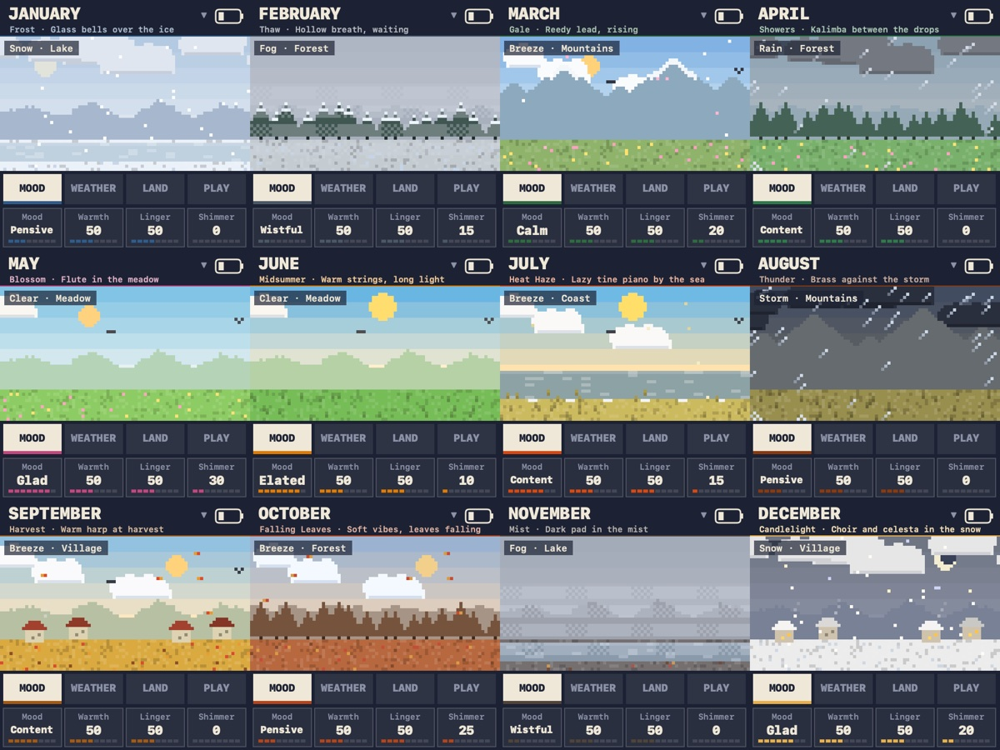

# Almanac

Almanac is the year as twelve sounds, on the MF-1 engine. It is a mode of MF-1: View › Almanac Mode switches to it
and back, relaunching the app, and `--almanac` starts in it. Like iScream, it has its own state folder and MIDI port
("Almanac (FM-1 Compatible)"), so it never touches MF-1's patches.

Each month is a voice, a sky, a place and a mood, and the screen is a small pixel-art landscape of that day. It moves
at a few frames a second: clouds drift with the gusts, rain and snow fall, leaves blow, lightning flashes, and notes
rise from the ground as motes when you play.

## The months

| Month | Voice | Sky | Place | Mood | Chord | Keys play |
|---|---|---|---|---|---|---|
| January | Frost: glass bells | Snow | Lake | Pensive | open fifths | chords, open: bells ringing over the ice |
| February | Thaw: hollow ocarina | Fog | Forest | Wistful | minor ninth | single notes: a lone breath, waiting |
| March | Gale: reedy lead that rises into each note | Breeze | Mountains | Calm | suspended fourth | split, open: a lead over a drone, like wind on the hills |
| April | Showers: kalimba | Rain | Forest | Content | add nine | a pattern of random drops |
| May | Blossom: flute with a chiff | Clear | Meadow | Glad | six-nine | single notes: a flute's tune |
| June | Midsummer: warm strings | Clear | Meadow | Elated | major ninth | chords, wide: lush strings |
| July | Heat Haze: lazy tine piano | Breeze | Coast | Content | ninth | a lazy pattern, in the order played |
| August | Thunder: brass | Storm | Mountains | Pensive | low root under a seventh | chords, wide: brass stabs |
| September | Harvest: warm harp | Breeze | Village | Content | major, spread | a pattern, open: the harp strummed upwards |
| October | Falling Leaves: soft vibes | Breeze | Forest | Pensive | minor seventh | a pattern falling, like leaves |
| November | Mist: dark hollow pad | Fog | Lake | Wistful | low minor | split, wide: a deep drone in the mist |
| December | Candlelight: choir and celesta | Snow | Village | Glad | major seventh | chords, open: the choir |

## How it is made

Every month is one DX7 voice on algorithm 5. The first two stacks (OP1-OP4) are the music. The third stack (OP5 and
OP6) is the weather, heard under every note:

| Sky | The weather in the voice | Effects, scaled by Weather |
|---|---|---|
| Clear | silent | none |
| Breeze | a breathy whistle two octaves up, swelling in and gusting with the LFO | chorus |
| Rain | glassy drips high above the note, pattering with a sample-and-hold LFO | duller low pass, light chorus |
| Fog | a soft hum an octave down, like a far foghorn | dark low pass, slow chorus |
| Storm | a rough, inharmonic growl an octave down, shaken at random | drive, phaser, low pass |
| Snow | a faint glint high up | thin high pass, slow phaser |

The weather is tuned to the key, not noise. The FM-1 has no noise source, and with V15's weaker feedback no setting
of two fixed-frequency operators measured as noise, so wind and rain are tuned textures that follow the music.

The place sets the reverb and the echo: Meadow (a little room, a short echo), Forest (quick clustered echoes),
Mountains (hall, a long echo off the far side), Coast (wide and slow), Lake (a bright plate, a long ring) and Village
(plate, a slap back).

## Controls

- **MONTH** (the PRESETS knob) picks the month; `<` and `>` do the same.
- **SKY** (the ALGORITHM knob) steps the weather. The SKY button does the same.
- **PAGE** (the SELECT knob) moves KNOB1-4 between four pages. MOOD, WTHR, LAND and PLAY jump straight there.
  - **Mood**: Mood (wistful opens notes slowly, darkens them and lets the two stacks drift out of tune; glad opens
    them quickly and brightens them), Warmth (brightness), Linger (release, and decay for the plucked months),
    Shimmer (vibrato).
  - **Weather**: Sky, Weather (how strongly the sky colours the sound through the effects), Elements (how loud the
    weather itself is; 0 is none), Gusts (how fast it moves).
  - **Land**: Place, Distance (reverb; 0 is off), Echo (delay; 0 is off), Space (how large the place sounds).
  - **Play**: how a key plays; each month starts with its own (the table above). Style is Single, Chord (the
    month's chord on each key), Split (the lowest twelve keys hold a drone of the root and fifth below, the rest
    play single notes) or Pattern (the month's chord on the arpeggiator, in the month's own order: random drips in
    January and April, falling in February and October, rising in May). Voicing is Close, Open (the second note
    lifted an octave) or Wide (a low root added, and an extra octave for patterns). Tempo and Notes set a
    pattern's speed.
  - The STYLE and VOICE buttons step through the styles and voicings.
- Hold **RESET** (the SAVE button) to put the month back as composed.
- Every month keeps how you left it, in `~/Library/Application Support/Almanac/days.json`.
- On the screen: click a page to show it, click a value to step it, drag or scroll on it to turn it, click the
  picture for the next sky, and click the month name for the list.

## Honesty about parity

- Almanac uses only what a real FM-1 has: DX7 voice parameters, the six effects, and the arpeggiator for patterns.
  Faithful mode is always on and Extended mode off.
- Chords and splits are made by the front end, which presses several notes for one key, as the firmware will. MIDI
  notes from outside are played as single notes.
- File › Export Month Bank writes the twelve months, each under its own sky, as an ordinary DX7 bank. The effects and
  the playing style are not in it.
- Voice changes reach the next note, as on the FM-1 with V15 behaviour on. Effect changes are immediate.
- The sounds were designed with numbers, not by ear: `mf1-render ... almanac-report` prints each month's level and
  how it moves, and the weather alone under each sky. They have not been auditioned on a real FM-1.
- The scene is drawn by `Sources/AlmanacCore/scene.c`, plain C with integer arithmetic, which the firmware compiles
  too, so the FM-1 draws the same pictures.

## On the FM-1

Almanac is one of the modes of the FM-1 firmware in `firmware/fm1-modes` (hold a piano key at power-on and press G).
Its sound mapping, in `firmware/almanac`, is a C port of AlmanacCore, which `firmware/almanac/tests/run_parity.sh` checks gives the desktop's voice bytes, effects,
pattern settings and key notes for every value of every field. Patterns play on a port of MF-1's arpeggiator in the
audio interrupt, since the firmware's engine has none. It runs on one unit: it boots, plays and logged no crash. CPU
load and the pattern's timing on the hardware are not measured yet.

## Tools

- `mf1-render <banks> almanac-test`: the Almanac checks alone (they also run in `test`).
- `mf1-render <banks> almanac-report [note]`: loudness and movement per month, and the weather alone per sky.
- `mf1-render <banks> almanac-weather <sky> <elements>`: the weather's level over two seconds.
- `MF-1 --almanac --snapshot out.png [screen|sheet] [month N] [page N] [sky N] [place N] [mood N] [play N] [step N]`:
  renders the panel, the screen at four times the size, or every month's screen on one sheet, at animation step N.
- `MF-1 --almanac --selfcheck`: drives the model as the panel would and checks the engine follows.
